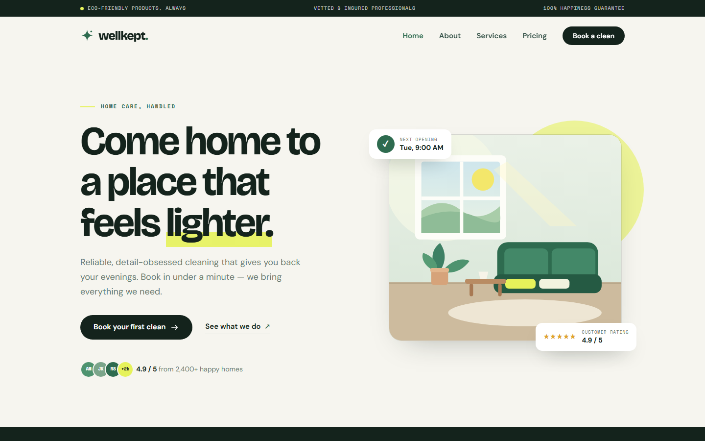
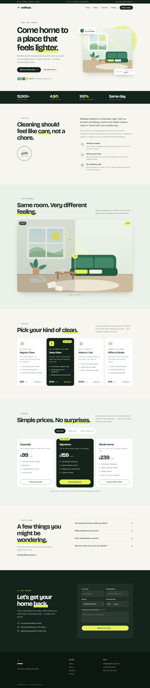

# Wellkept — Home care, handled.

A polished, responsive landing page for a home-cleaning service. Built with plain HTML, CSS and JavaScript — no framework, no build step, and no external network requests. All fonts and illustrations are stored locally, so the page works offline.

## Preview



<details>
<summary>Full page — desktop (1440px)</summary>



</details>

<details>
<summary>Full page — mobile (390px)</summary>


</details>

## Features

- **Responsive design** — fluid typography and layouts with breakpoints at 1100, 900, 700 and 480px.
- **Before / after slider** — draggable comparison with pointer events, keyboard controls (arrows, Home, End) and proper `role="slider"` semantics.
- **Pricing toggle** — switches between one-time, weekly and bi-weekly prices with a short flip animation.
- **Mobile navigation** — accessible menu that closes on link click, `Escape`, or an outside click.
- **Scroll interactions** — `IntersectionObserver` reveals content on entry and highlights the section currently in view in the navigation.
- **Booking form** — client-side validation with inline error states, focus management and a live status message.
- **Accessibility** — visible focus rings, ARIA labels and states, keyboard-operable controls, and a `prefers-reduced-motion` fallback.
- **Fully local** — self-hosted fonts and SVG artwork; no CDN, dependencies or internet connection required.

## Quick start

Open `index.html` directly in any modern browser. That's it.

If you prefer to serve it over HTTP:

```bash
python -m http.server 8000
```

Then visit <http://localhost:8000>.

## Project structure

```
.
├── index.html          # Page markup and content
├── styles.css          # Design tokens, components and responsive rules
├── script.js           # UI interactions
├── fonts/              # Self-hosted WOFF2 fonts
├── img/                # SVG illustrations
└── screenshots/        # Preview images used in this README
```

## Customization

- **Colors, fonts and spacing** are defined as CSS custom properties in the `:root` block at the top of `styles.css`. Change a token there and it updates across the page.
- **Copy and images** live in `index.html`; the SVG illustrations in `img/` can be swapped for your own assets.
- **Behavior** is organized into small `init*` functions in `script.js`, one per feature, so individual interactions can be tweaked independently.

## Browser support

Works in current versions of Chrome, Edge, Firefox and Safari. Features that rely on `IntersectionObserver` gracefully fall back to showing all content when it isn't available.
